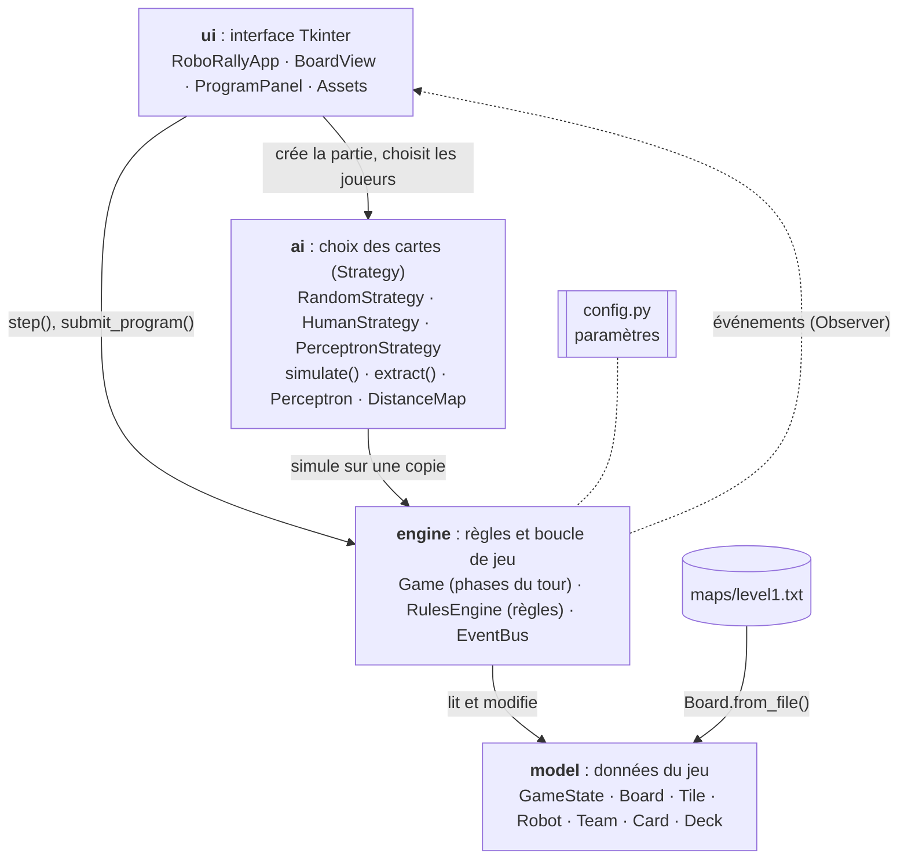
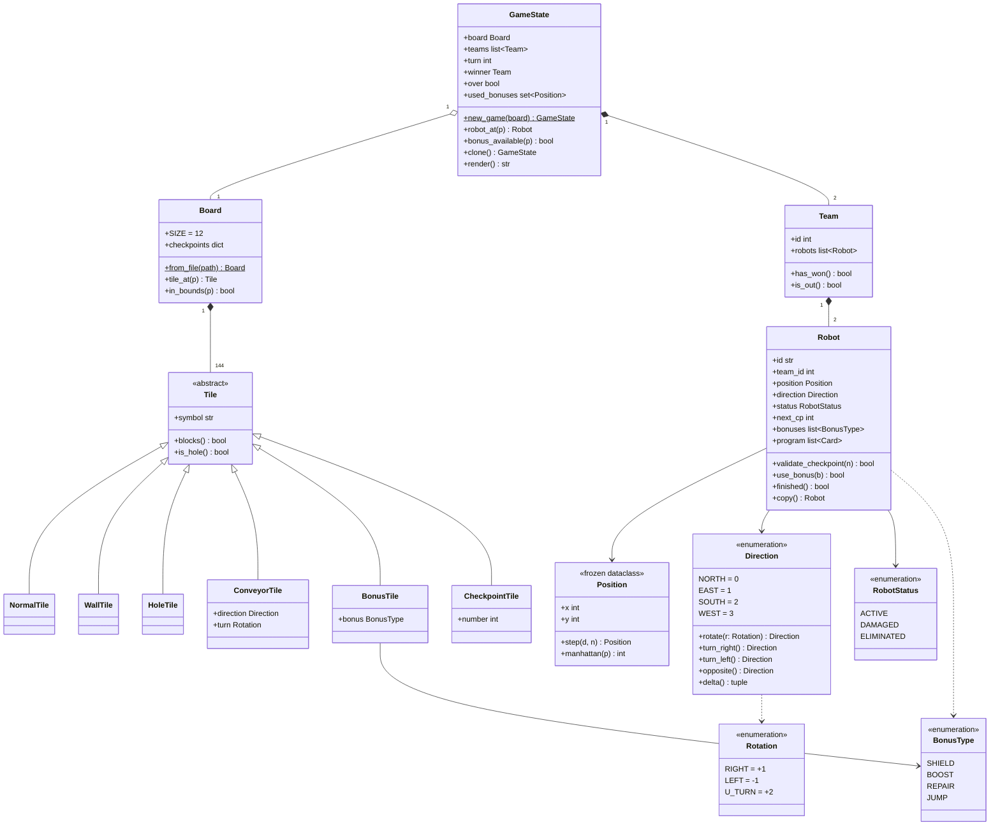
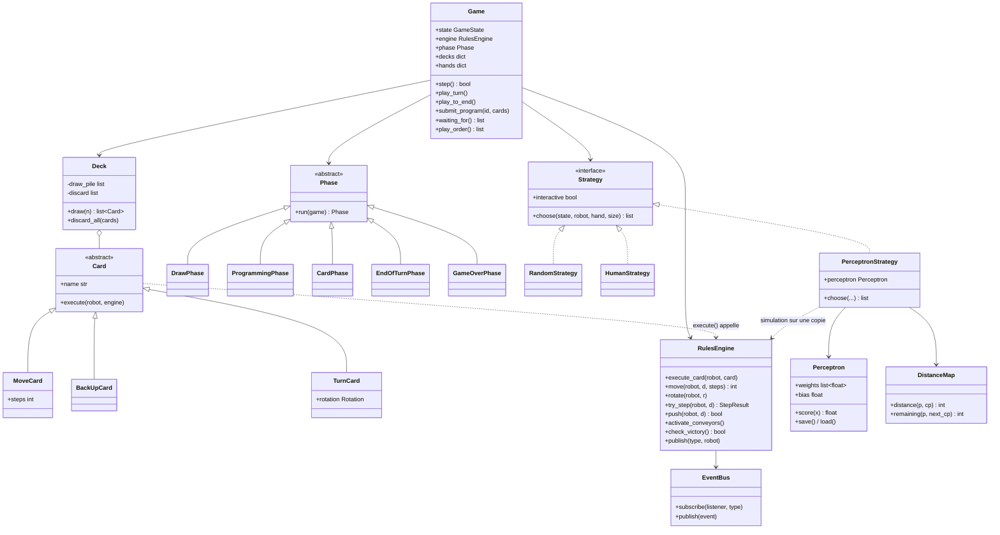
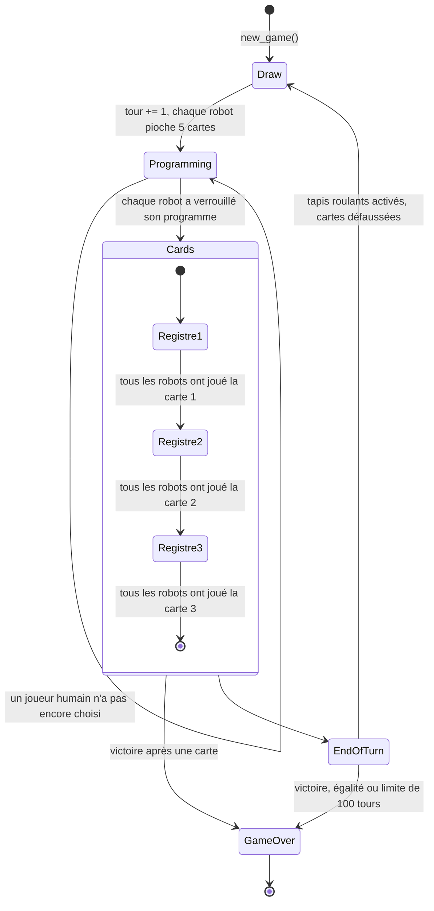
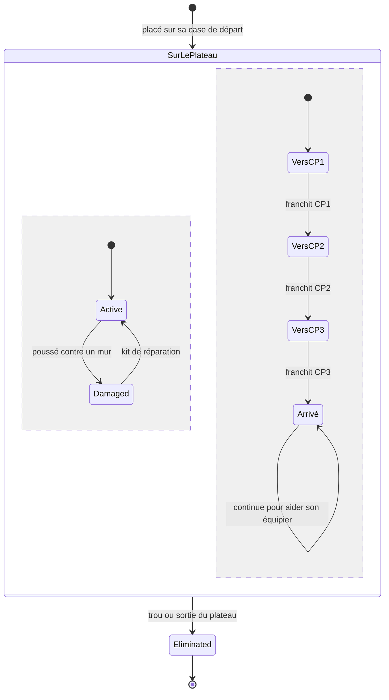
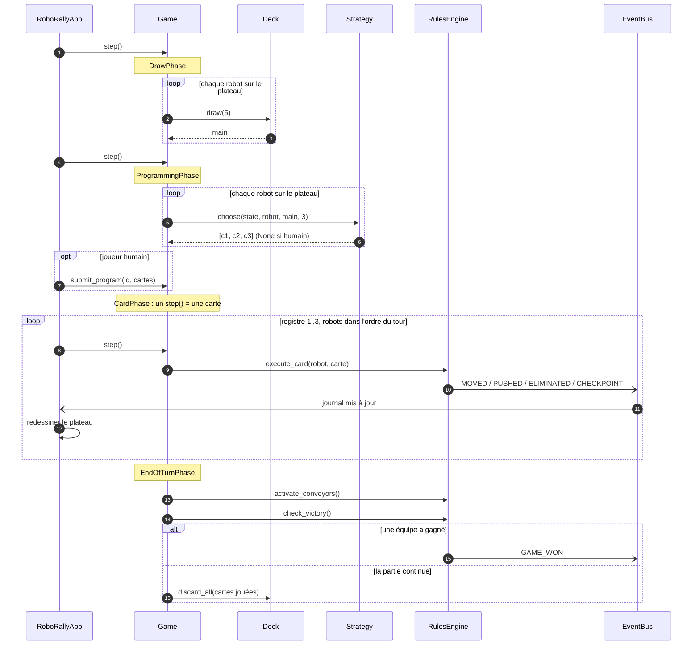
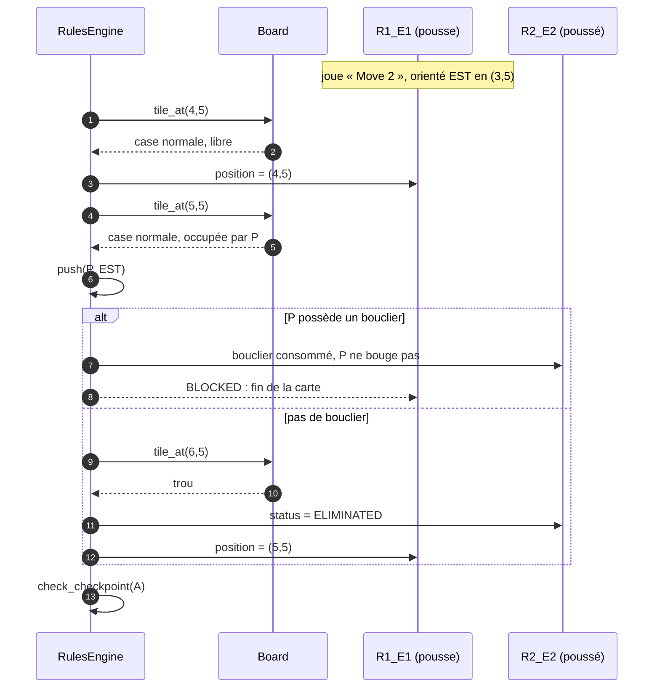
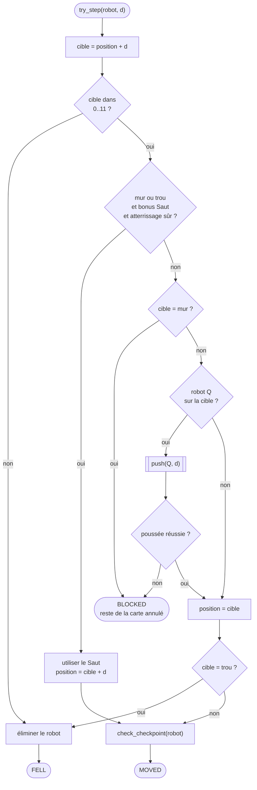
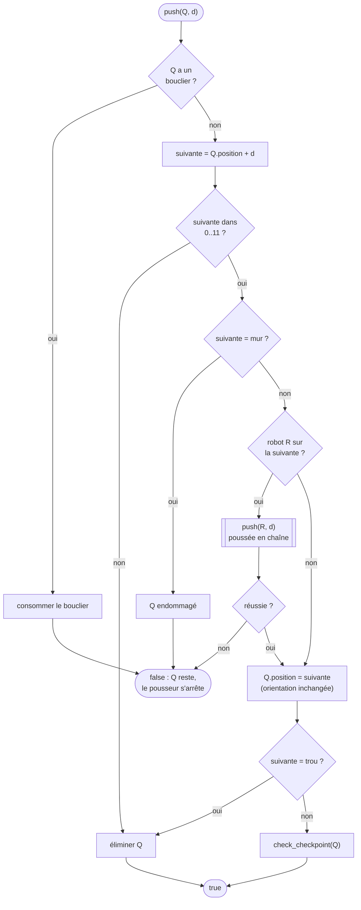
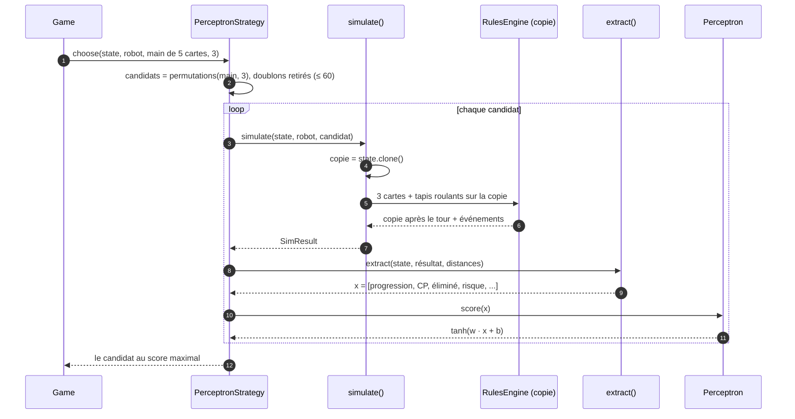

# Robo Rallye — diagrammes UML

Sources Mermaid des diagrammes du rapport (`docs/Rapport_Robo_Rally.docx`), à jour avec le code final.
Ils s’affichent directement sur GitHub, ou dans VS Code avec l’extension « Markdown Preview Mermaid Support».

## Architecture en couches

## Diagramme de classes : modèle

## Diagramme de classes : moteur, cartes et IA

## Diagramme d’états : un tour de jeu

## Diagramme d’états : un robot

## Diagramme de séquence : un tour complet

## Diagramme de séquence : poussée dans un trou

## Algorithme : try_step

## Algorithme : push

## Diagramme de séquence : décision de l’IA

